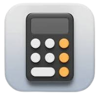

# Calculator

A sleek, responsive calculator built with plain HTML, CSS, and JavaScript. This project focuses on a clean neumorphic interface, smooth interactions, and an easy-to-use numeric layout.



## Overview

This calculator is a lightweight front-end web app designed for quick arithmetic operations such as addition, subtraction, multiplication, division, percentage calculations, and decimal input. It is fully static and can be opened directly in a browser without requiring any build tools or dependencies.

## Features

- Modern neumorphic button design
- Responsive layout for desktop and mobile screens
- Basic arithmetic operations
- Percentage conversion support
- Clear and reset function
- Lightweight implementation using only vanilla web technologies

## Tech Stack

- HTML5
- CSS3
- JavaScript

## Project Structure

```text
Calculator/
├── index.html
├── style.css
├── script.js
├── assets/
│   └── calculator-icon.png
├── README.md
└── LICENSE
```

## Run Locally

1. Clone the repository:

```bash
git clone https://github.com/sachin35544/Calculator.git
```

2. Open the project folder:

```bash
cd Calculator
```

3. Launch `index.html` in your browser.

You can also use a local preview extension or a simple static server if preferred.

## Usage

- Click the number buttons to enter values.
- Use operator buttons for calculations.
- Press `=` to evaluate the expression.
- Use `AC` to reset the display.
- Use `%` to convert the current value to a percentage.

## Author

- [@sachin35544](https://github.com/sachin35544)

## Feedback

If you have any feedback, suggestions, or improvements, feel free to reach out at:

- kumawatsachin0987@gmail.com

## License

This project is licensed under the [MIT License](LICENSE).
